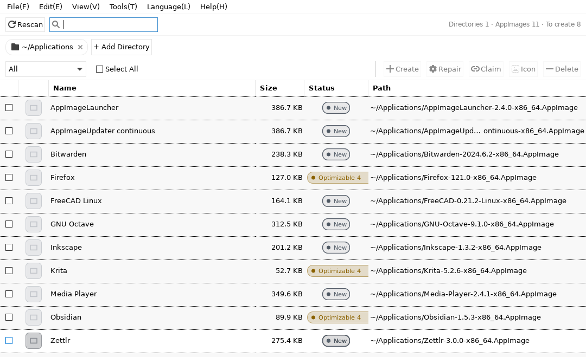
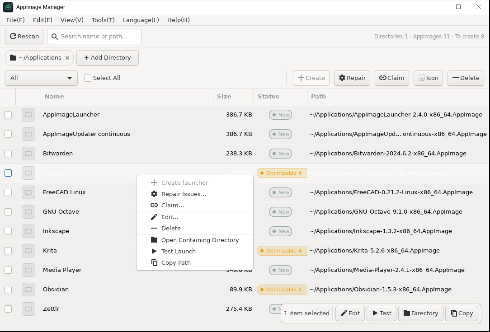
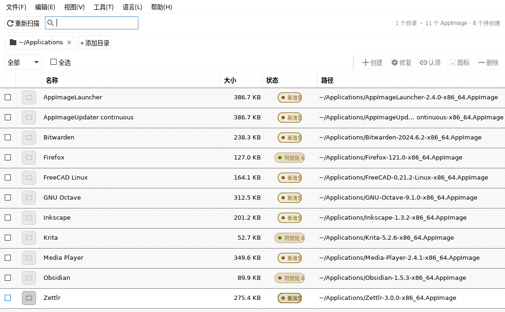

# AppImage Manager

[](https://github.com/DarkLord-W/appimage-manager/actions/workflows/ci.yml)
[](https://github.com/DarkLord-W/appimage-manager/releases)
[](LICENSE)

[Screenshots](#screenshots) · [Download](#download) · [Usage](#usage) · [How it edits your files](#how-it-edits-your-files) · [Building](#building)

English | [简体中文](README.md)

Scans the directories you point it at, turns the AppImages it finds into proper desktop launchers, and keeps checking whether those launchers still work.

The appeal of AppImage is that there is nothing to install. The catch is that
nothing does the work an installer would have done: no `.desktop` file, no icon,
no entry in the application menu, no MimeType associations. Writing a usable
launcher by hand takes a dozen lines and a working knowledge of the XDG escaping
rules. Get it wrong and the icon does not appear, the app does not show up in
search, and the link breaks the moment you move the AppImage somewhere else.
Give it a few months and `~/.local/share/applications` is full of them.

This tool deals with that. It never touches your AppImages, only the launchers
around them, and every change comes with a diff preview, a backup and a way to
undo it. Written in Vala + GTK3, builds to a single native binary.

## Screenshots

#### Main window



One row per AppImage with its current state on the right. Filtering and search
both work.

#### Creating a launcher


Fields are pre-filled from the filename, and the panel on the right shows the
exact `.desktop` file that will be written.

#### Checking and repairing


Every problem is listed with the rule it hit and the suggested fix, with a
unified diff at the bottom.

#### Context menu



Per-entry actions live here; batch actions are on the action bar at the top.

Simplified Chinese interface:



## Download

Grab one from [Releases](https://github.com/DarkLord-W/appimage-manager/releases):

| File | Notes |
|---|---|
| `AppImage-Manager-*-x86_64.AppImage` | No install. `chmod +x` and run |
| `appimage-manager_*_amd64.deb` | Debian / Ubuntu / Kali / Mint |
| `appimage-manager-*.x86_64.rpm` | Fedora / RHEL / openSUSE |
| `appimage-manager-*.pkg.tar.zst` | Arch / Manjaro |
| `appimage-manager-*-linux-x86_64.tar.gz` | Unpack and run, no root needed |

The AppImage and tarball builds use the GTK3 already on your system; every
desktop distribution has it. The deb / rpm / arch packages declare the
dependency, so installing them pulls it in.

On Arch you can also use the AUR: `appimage-manager` builds from source and
runs the test suite; `appimage-manager-bin` unpacks the released AppImage and
installs in seconds. Both install the same set of files and conflict with each
other, so pick one. The binaries themselves are built separately (one in CI,
one on your machine), so they are not byte-identical.

To build from source, see [Building](#building).

## Usage

### Scanning

Add directories under "Add Directory". You can add several, and subdirectories
are scanned recursively.

There are four states. "New" means there is no launcher yet. "Optimizable" means
a launcher exists but has problems, and the number tells you how many.
"External" means the launcher was created by something else or written by hand,
and this tool leaves it alone. "Created" means it is managed here. New and
Optimizable are both amber; the difference is that Optimizable carries a problem
count.

### Creating a launcher

Tick the entries you want and click "Create" in the action bar.

A few fields are pre-filled from the filename
(`Obsidian-1.5.3-x86_64.AppImage` becomes `Obsidian`). Name, categories, comment
and icon are all editable. Categories is an editable dropdown that suggests
values by keyword: type `krita` and it offers `Graphics;`. The icon field starts
empty; click "Choose…" to pick a file from disk (png, svg or xpm), which gets
copied into the icon cache with a 32 px preview next to the field.

In batch mode you get one dialog per entry, and you can skip a single one or
tick "use these defaults for the rest" to get through them all.

Nothing is unpacked during creation. The whole path is string manipulation, it
finishes in milliseconds and cannot hang on a large file. If you do want the
metadata stored inside the AppImage (real name, icon, categories), click "Try to
Extract Embedded Metadata" in the dialog. That step unpacks, so it has a hard
60-second timeout, can be cancelled at any moment, and cleans up after itself on
failure while telling you why.

### Checking and repairing

Select an entry and click "Repair", or just double-click it.

Every problem is listed with the rule it hit, its current value, and what the
tool intends to change it to. In the middle you pick a repair mode:

- **Conservative**: fix only what is definitely broken, leave every existing
  field untouched byte for byte
- **Complete**: conservative plus filling in missing standard fields. Only adds,
  never overwrites
- **Rebuild**: replace everything using the AppImage's metadata. Your custom
  content has to be ticked individually to survive

Below that you choose which existing content to preserve (a `Name` you edited,
say) and whether to normalize the filename. At the bottom is a unified diff.
Nothing is written until you confirm.

### Context menu

Per-entry actions live here. The split with the action bar is deliberate: the
bar handles batch operations (create, repair, claim, icons, delete) and the
context menu handles a single entry (edit, test run, open containing directory,
copy path). The floating action bar in the bottom-right offers the same
single-entry actions.

Target selection is "ticked entries win; with nothing ticked it falls back to
the selected row". Buttons enable and disable based on state, and a disabled
button explains why in its tooltip.

### Working with existing launchers

Launchers that already exist can be brought under management:

- **Claim**: take a third-party or hand-written `.desktop` under management by
  appending only the `X-AppImage-Manager-*` marker keys. Nothing else changes
- **Fill from embedded metadata**: unpack the AppImage, read the real name,
  comment, categories and icon from the `.desktop` inside it, and apply them to
  the existing launcher. Only fields the AppImage actually specifies are
  replaced, and only the lines whose values genuinely changed are rewritten
- **Delete**: backed up first, restorable later from Repair History
- **Clean up**: handles stale launchers (whose AppImage is gone) and orphaned
  icons in one pass

### First run

There is no wizard. The main window opens straight into an empty state with two
buttons: "Add Directory" and "Show Common Locations". The latter lists
`~/Applications`, `~/apps` and similar; tick them and any that do not exist are
created.

## How it edits your files

This is the part of the project worth reading.

Claim, repair and fill-in all rewrite your `.desktop` files. They only touch the
lines they have confirmed they need to change and preserve the rest byte for
byte:

- Comments and blank lines are left alone
- Non-standard spacing like `Name = Foo` is not "normalized"
- Extra groups such as `[Desktop Action …]` survive intact
- Idempotent: running the same operation twice does not stack up duplicates

Parsing the file into key/value pairs and serializing the whole thing back is the
easy way to implement this, and it eats every one of those details. Claim a
carefully hand-written launcher and you would lose the comments and the entire
action group, which directly contradicts the promise of appending two marker
lines. So these three operations go through byte-level insertion and minimal
line-level rewriting instead.

Writes are atomic: a temp file is written and `fsync`ed, then `rename`d over the
target. A desktop environment reading concurrently sees either the old file or
the new one, never a half-written one.

Every operation is also recorded. The intent goes into the journal first and the
completion is marked after, so an interrupted run is detected on startup and can
be rolled back in one click. Repair history is append-only, so any earlier state
can be restored, and a restore is itself recorded. Backups are kept for 30 days /
200 transactions by default.

## Health checks

Existing `.desktop` files get a checkup against 28 rules, graded in four levels:

| Level | Examples |
|---|---|
| Fatal | Missing `[Desktop Entry]` header, UTF-8 BOM, CRLF line endings, invalid bytes in the encoding |
| Critical | `Version=` out of range, unescaped `Exec=`, `Exec=` pointing at a missing file, wrong `Type=`, duplicate keys, `Actions=` referencing a group that does not exist |
| Warning | Missing `Icon=`, missing `Categories=`, missing `StartupWMClass=`, `Terminal=true`, non-standard filename |
| Notice | Missing `GenericName=`, missing `TryExec=`, not managed by this tool |

## Interface languages

The Language menu has three entries: Follow system, 简体中文, English.

First run follows the system locale. If `LANG` / `LC_MESSAGES` does not contain
`zh`, you get English without having to go looking through a menu first.
Switching shows an infobar with a Restart Now button. It restarts rather than
switching in place because GTK widget text is fixed at construction time;
replacing it live would mean rebuilding the whole widget tree, which costs more
than it is worth.

GTK's own widgets (file chooser, colour chooser) follow along too, by setting
`LANGUAGE` before GTK initialises. Without that you get a Chinese interface
popping up an English file dialog.

Implementation details are under [Design notes](#design-notes).

## Keyboard shortcuts

| Key | Action | Key | Action |
|---|---|---|---|
| `F5` / `Ctrl+R` | Rescan | `Enter` | Create / claim / edit |
| `Ctrl+A` | Select all | `Delete` | Delete selected launchers |
| `Ctrl+F` | Focus search | `F11` | Maximize / restore |
| `Ctrl+N` | Create launcher | `F1` | Keyboard shortcuts |
| `Ctrl+D` | Add scan directory | `Ctrl+Q` | Quit |
| `Ctrl+,` | Settings | Double-click a row | Create if new, edit if it exists |

The window uses the native title bar drawn by the window manager; nothing is
custom-drawn. A custom title bar tends to render minimize and maximize as blank
circles under third-party GTK themes, and handing it to the window manager avoids
that entirely.

There is a maximize, but no fullscreen. Under X11 a real fullscreen makes the
window manager drop every decoration, so the title bar and all three buttons
disappear together and it looks like the buttons are broken. Maximizing fills the
screen while keeping the title bar.

Minimum window size is 620 × 560. Below 880 px wide the floating action bar in
the bottom-right retracts automatically, so it does not cover the last few rows of
the list.

## Building

Dependencies:

```bash
# Debian / Ubuntu / Kali
sudo apt install valac libgtk-3-dev libjson-glib-dev pkg-config

# Fedora
sudo dnf install vala gtk3-devel json-glib-devel pkgconfig

# Arch
sudo pacman -S vala gtk3 json-glib pkgconf
```

Requires Vala ≥ 0.48 and GTK ≥ 3.24.

```bash
make          # produces ./appimage-manager
make run      # build and run
```

Installing:

```bash
sudo make install                  # /usr/local by default
make install PREFIX=$HOME/.local   # or into your home directory
sudo make uninstall                # uninstall
```

Three files are installed: `$PREFIX/bin/appimage-manager`,
`$PREFIX/share/applications/appimage-manager.desktop`, and
`$PREFIX/share/icons/hicolor/256x256/apps/appimage-manager.png`.

### Tests

```bash
make selftest        # 257 engine self-tests, no graphical environment needed
tests/ui-test.sh     # 21 UI automation steps, needs the tools below
```

The UI suite additionally needs:

```bash
sudo apt install desktop-file-utils xvfb xfwm4 xdotool imagemagick xclip
```

When a tool is missing, `ui-test.sh` skips and exits 0, so an incomplete local
setup is never mistaken for a failure. That is also exactly why the workflow that
runs it has to install every tool, otherwise it hands back a green false pass.

The two suites run separately in CI. `ci.yml` runs the build, the engine
self-tests and the packaging check on every push, about two minutes. `ui-test.yml`
runs the UI automation manually or weekly, about fifty minutes. `release.yml`
runs the build, self-tests, packaging and artifact verification on a tag.

The UI suite is kept off the per-push path for three reasons. It is slow (over 55
minutes locally, so a 15-minute job would kill it and report a failure unrelated
to the code). It is brittle, asserting on pixel scans and hard-coded coordinates,
so any UI change may require recalibration. And the class of bug it catches is
narrow; the ones only it can find are worth running regularly, not on every push.

### Packaging as an AppImage

```bash
make appimage
# → dist/AppImage-Manager-1.1.0-x86_64.AppImage
```

The result lands between 0.5 and 1.3 MB depending on which runtime it uses. The
runtime is the AppImage launcher (an AppImage is `ELF runtime ++ squashfs`), and
this project does not build it. A local `make appimage` carves one out of an
AppImage already on the machine, typically the classic runtime at around 180 KB;
the CI behind the releases uses AppImageKit's official type2-runtime, 944 KB,
musl-static and independent of the host glibc. Size is what that costs.

Strip the runtime and the application itself compresses to about 280 KB, which is
what not bundling GTK buys you. True self-containment would mean pulling in the
whole GTK stack, pushing the size past 100 MB and dragging in glibc compatibility
problems, which is not a good trade for a tool like this.

Packaging needs no network access and no `appimagetool`. The script takes the
runtime out of any type-2 AppImage already on the machine and assembles the bundle
itself with the system `mksquashfs`. The runtime is located in this order, first
usable one wins:

1. The `RUNTIME=/path/to/runtime` environment variable
2. `runtime/appimage-runtime-x86_64` in the repo, cached there after the first
   successful run
3. Extracted from an AppImage already on the machine: first
   `$APPMGR_RUNTIME_SOURCE`, then `~/Desktop/audit/dl/*.AppImage`, then
   `/tmp/*.AppImage`

The runtime length comes from the AppImage's own reported `--appimage-offset`, not
from searching the file for the `hsqs` magic. The runtime's own code contains
those four bytes, so a naive search hits a false positive and slices out a
crippled runtime that starts but segfaults on `--appimage-extract`. Every
candidate must pass a round-trip check (rebuilt offset matches what it reports,
and extraction exits 0) before it is accepted.

### Packaging as deb / rpm / arch

```bash
# The .desktop file has an @PREFIX@ placeholder that needs substituting and
# nfpm does not substitute, so stage the substituted files first:
make install DESTDIR=build/pkg PREFIX=/usr

cd packaging
nfpm package --config nfpm.yaml --packager deb       --target ../dist
nfpm package --config nfpm.yaml --packager rpm       --target ../dist
nfpm package --config nfpm.yaml --packager archlinux --target ../dist
```

This uses [nfpm](https://nfpm.goreleaser.com/) rather than three separate
`debian/rules` + `.spec` + `PKGBUILD` files. One config generates all three
package types, and each family names its dependencies differently (GTK3 is
`libgtk-3-0` on deb, `libgtk-3-0t64` on newer releases, and `gtk3` on rpm and
arch), so keeping it in one place is more reliable than three. The config is
`packaging/nfpm.yaml`; dependency changes go there.

## File locations

| Purpose | Path |
|---|---|
| Config | `~/.config/appimage-manager/config.ini` |
| Launcher write target | `~/.local/share/applications/` |
| Icon cache | `~/.local/share/icons/hicolor/<size>/apps/` |
| Transaction log | `~/.local/share/appimage-manager/journal/` |
| Backups and history | `~/.local/share/appimage-manager/history/` |
| Extraction scratch | `~/.cache/appimage-manager/extract/` |

The launcher directory follows the XDG spec (`$XDG_DATA_HOME`) and takes
precedence over `/usr/share/applications` in the menu search order, so a per-user
launcher overrides a system-wide entry of the same name.

## Project structure

```
src/
├── main.vala           Entry point, Gtk.Application wiring
├── window.vala         Main window: list, directory chips, floating bar, InfoBar
├── dialogs.vala        Editor / repair / claim / cleanup / settings / history / progress
├── menubar.vala        Menu bar
├── prefill.vala        Derives prefill values from filename and AppImage
├── pill.vala           Custom cell renderer for the status pills
├── store.vala          Data model, two-dimensional state (match × health)
├── config.vala         GKeyFile config persistence
├── scanner.vala        Recursive scan and magic validation
├── appimage.vala       --appimage-extract metadata and icon extraction
├── desktopfiles.vala   Entry parsing, Exec escaping, atomic writes, validation
├── rules.vala          28 health-check rules
├── repair.vala         Three repair modes, diff generation, byte-level rewriting
├── journal.vala        WAL two-phase transactions, crash recovery
├── backup.vala         Backup storage, append-only history, restore
├── i18n.vala           Chinese/English string table
├── version.vala        Version number
└── paths.vala          XDG path resolution, file operation shim
data/
├── style.css                            GTK3 stylesheet, theme-adaptive
├── appimage-manager.png                 Application icon
├── appimage-manager.desktop.in          Installed .desktop template
└── appimage-manager-appimage.desktop.in .desktop template embedded in the AppImage
scripts/
└── make-appimage.sh    Offline AppImage packaging
tests/
├── selftest.vala       Engine self-tests, no GUI
├── ui-test.sh          UI automation via Xvfb + xdotool
├── ui-helpers.sh       Assertion and screenshot helpers
└── make-fixtures.sh    Generates fake AppImages and 21 malformed .desktop files
```

## Design notes

**State has two dimensions.** "Match state" (new / created / external / broken)
and "health state" (healthy / optimizable / damaged) are orthogonal, so a status
pill reflects both at once. Collapsing those into a single enum is why a lot of
similar tools become unmanageable as they grow.

**Slow operations do not block the UI.** Icon extraction unpacks an AppImage —
tens to hundreds of MB per file — so it runs on a background thread behind a
cancellable progress bar. Writing a `.desktop` file takes milliseconds and runs
synchronously.

**Transaction boundaries are kept short.** All the concurrency happens before the
transaction; inside it there is nothing but file operations. That keeps how long a
transaction is held predictable, and removes the need to handle concurrency inside
one.

**Every automatic repair is reversible.** The original is backed up first, history
is append-only, and a restore is itself a new record, so the history never ends up
inconsistent with the files.

**Translation does not bring in gettext.** The 570 UI strings live in a table in
`src/i18n.vala`, compiled into the binary. That removes any need for `.po` files
and `msgfmt`, keeping a layer of dependencies out of CI and all three distro
packages. A missing entry falls back to Chinese rather than rendering blank. The
trade-off is that the community cannot use .po tooling; translations have to be
made as code changes.

## Known limitations

- `--appimage-extract` requires the file to be executable. This tool never changes
  your AppImages on its own: when it meets a file without the executable bit it
  asks, and the default answer is to leave it alone. Files under `/opt` or `/media`
  may need administrator rights, in which case setting the bit fails and it says
  so rather than pretending it worked
- Unpacking can be slow, tens of seconds to minutes for a large file. The timeout
  is configurable (60 seconds by default, range 5 to 600) and it can be cancelled
  at any time. Cancelling or timing out kills the child process outright, leaving
  nothing running
- Encrypted and split (`.part`) AppImages are not supported for icon extraction or
  unpacking
- Launcher directories outside `~/.local/share/applications` are not managed. A
  launcher living elsewhere can be claimed, but scanning will not see it, and
  claiming asks about that
- The packaged AppImage depends on the system GTK3; GTK is not bundled

## License

GPL-3.0-or-later, full text in [LICENSE](LICENSE).

This program is free software: you can redistribute it and/or modify it under
the terms of the GNU General Public License as published by the Free Software
Foundation, either version 3 of the License, or (at your option) any later
version. This program is distributed in the hope that it will be useful, but
WITHOUT ANY WARRANTY; without even the implied warranty of MERCHANTABILITY or
FITNESS FOR A PARTICULAR PURPOSE. See the GNU General Public License for more
details.

Each source file carries an `SPDX-License-Identifier: GPL-3.0-or-later` tag.

The source in this repository is the complete source. Distributing a binary (deb /
rpm / arch package, AppImage, tarball) requires making the corresponding complete
source available. Every tagged Release reproduces the full source for that
version: clone and `git checkout <sha>`.
