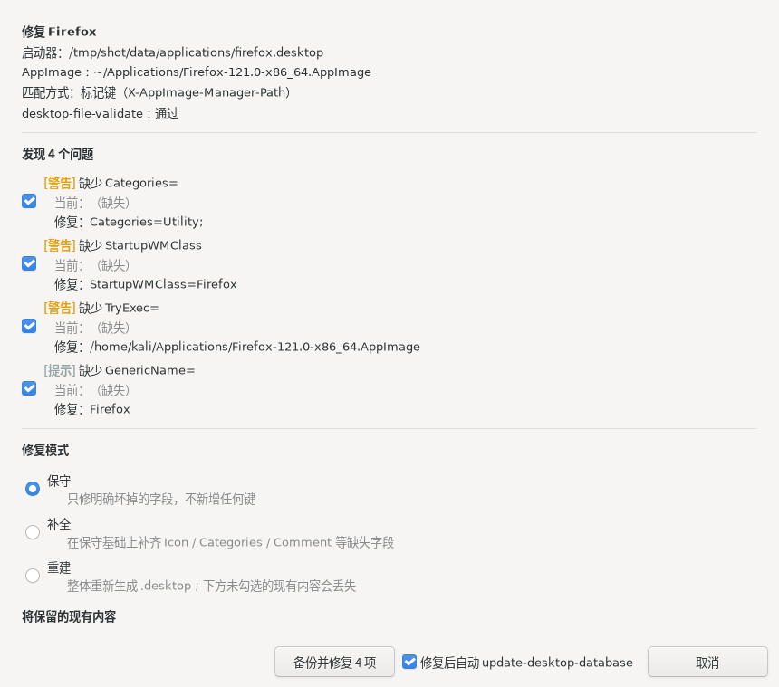
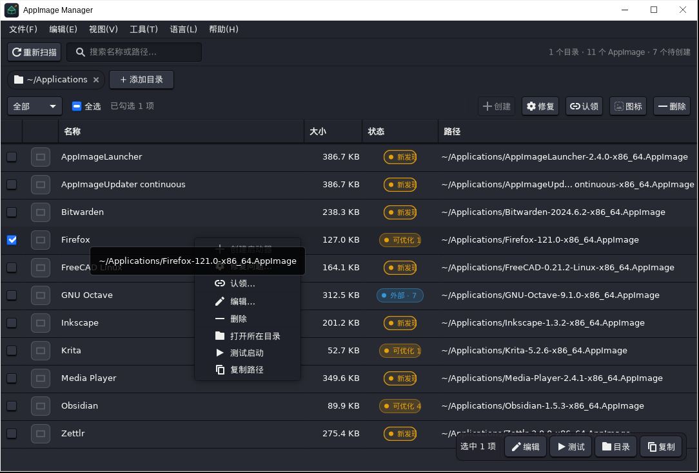

# AppImage Manager

[](https://github.com/DarkLord-W/appimage-manager/actions/workflows/ci.yml)
[](https://github.com/DarkLord-W/appimage-manager/releases)
[](LICENSE)

[截图](#截图) · [下载](#下载) · [用法](#用法) · [它是怎么改文件的](#它是怎么改文件的) · [编译](#编译)

[English](README.en.md) | 简体中文

扫描你指定的目录，把找到的 AppImage 变成规范的桌面启动器，并持续检查它们还好不好用。

AppImage 的好处是不用安装，代价是安装过程替你做的那些事没人做了：写
`.desktop`、装图标、登记到应用菜单、设置 MimeType 关联，全都得手动来。
写一个能用的启动器要十几行，还得记住 XDG 的转义规则。写错了图标不显示，
搜索里找不到，AppImage 挪个位置链接就失效。时间一长
`~/.local/share/applications` 里就堆满了这种东西。

这个工具解决的就是这件事。它不碰你的 AppImage，只负责生成和维护启动器；
每次改动都有 diff 预览、自动备份和回滚记录。Vala + GTK3 写的，编译出来
是一个原生二进制。

## 截图

#### 主界面


每行一个 AppImage，右边是当前状态。筛选和搜索都能用。

#### 创建启动器


字段从文件名预填，右边实时显示将要写入的 `.desktop` 全文。

#### 检查与修复



逐条列出问题、命中的规则、建议的改法，下面有 unified diff。

#### 右键菜单



单条操作在这里，批量操作在顶部操作条。

英文界面：


## 下载

从 [Releases](https://github.com/DarkLord-W/appimage-manager/releases) 取：

| 文件 | 说明 |
|---|---|
| `AppImage-Manager-*-x86_64.AppImage` | 免安装，`chmod +x` 之后直接跑 |
| `appimage-manager_*_amd64.deb` | Debian / Ubuntu / Kali / Mint |
| `appimage-manager-*.x86_64.rpm` | Fedora / RHEL / openSUSE |
| `appimage-manager-*.pkg.tar.zst` | Arch / Manjaro |
| `appimage-manager-*-linux-x86_64.tar.gz` | 解压即用，不需要 root |

AppImage 和 tar.gz 版依赖系统里已装的 GTK3，桌面发行版都有。deb / rpm /
arch 包会把依赖声明好，装的时候自动处理。

Arch 用户也可以走 AUR：`appimage-manager` 现场编译，编译完会跑一遍自测；
`appimage-manager-bin` 解包 Release 里的 AppImage，几秒钟装完。两个包装出来
的**文件树**一样，互相冲突，选一个就好。二进制是各自构建的（一个在 CI 上、
一个在你机器上），所以内容不会逐字节相同，这是正常的。

从源码编译见[编译](#编译)。

## 用法

### 扫描

在「添加目录」里填要扫描的目录，可以填多个，会递归进子目录。

状态分四种。「新发现」是还没有启动器的；「可优化」是启动器存在但有问题，
后面的数字是问题条数；「外部」是别的工具或用户手写的启动器，本工具不碰；
「已创建」是归本工具管的。新发现和可优化都是琥珀色，区别在后者带问题数。

### 创建启动器

勾选要处理的条目，点操作条上的「创建」。

对话框会根据文件名预填几个字段（`Obsidian-1.5.3-x86_64.AppImage` 推出
`Obsidian`），名称、分类、备注、图标都可以改。分类是个可编辑的下拉框，
输入 `krita` 会建议 `Graphics;`。图标默认是空的，点「选择…」从磁盘上挑
一张（png / svg / xpm 都行），文件会被复制进图标缓存，右边有 32px 预览。

批量创建时逐个弹窗，可以「跳过」单条，也可以勾上「之后都用默认值」一次
过完。

整个创建流程不做解包，是纯字符串操作，毫秒级完成，不会卡在某个大文件上。
想让它读 AppImage 内部的元数据（真实名称、图标、Categories），点对话框里
的「尝试提取内置元数据」。那一步会解包，所以带了 60 秒硬超时、可以随时
取消、失败会清理干净并说明原因。

### 检查与修复

选中条目点「修复」，或者直接双击。

上面列出所有问题，每条都标了命中的规则、当前值、以及打算改成什么。中间
选修复模式：

- **保守**：只改明确坏掉的，已存在的字段一个字节不动
- **补全**：在保守的基础上补齐缺失的标准字段，只补不覆盖
- **重建**：用 AppImage 的元数据整体重写，你自定义的内容要逐条勾选保留

下面勾选要保留哪些现有内容（比如你改过的 `Name`），以及是否规范化文件名。
最底下是 unified diff，确认之后才会写。

### 右键菜单

针对单条的操作在这里。和操作条分工明确：操作条管批量（创建、修复、认领、
图标、删除），右键菜单管单条（编辑、测试运行、打开所在目录、复制路径）。
右下角的浮动操作条提供同样的单条操作。

目标的选择规则是「勾选优先，没勾选就回退到当前行」。按钮按状态启用或禁用，
禁用的原因写在 tooltip 里。

### 反向管理

已经存在的启动器也能交进来管：

- **认领**：把第三方或手写的 `.desktop` 纳入管理。做法是只追加
  `X-AppImage-Manager-*` 几个标记键，原来的内容一个字不动
- **用内置元数据补全**：解开 AppImage，读里面那个 `.desktop` 的真实名称、
  描述、分类、图标，补到已有的启动器上。只会替换 AppImage 里确实写了的
  字段，而且只重写值真的变了的那几行
- **删除**：删之前自动备份，之后可以从「修复历史」里还原
- **清理**：一次处理失效的启动器（指向的 AppImage 不在了）和孤立的图标

### 首次运行

没有向导弹窗。主窗口直接打开，显示一个空状态页，两个按钮：「添加目录」和
「看看常见位置」。后者会列出 `~/Applications`、`~/apps` 这类常用位置，
勾选后不存在的目录会直接创建。

## 它是怎么改文件的

这一节是这个项目最该看的部分。

认领、修复、补全这三个操作会改写你的 `.desktop`。做法是只动确认要改的那
几行，其余部分逐字节保留：

- 注释和空行原样留下
- `Name = Foo` 这种带空格的非标准写法不会被"规范化"
- `[Desktop Action …]` 之类的附加组完整保留
- 幂等，同一个操作重复执行不会反复叠加内容

先把文件解析成键值对、再整体序列化写回去，是实现上最省事的做法，但它会把
这些细节全吃掉。认领一个精心写好的启动器，结果注释没了、附加组整组消失，
这跟「只追加两行标记」的说法直接矛盾。所以这三个操作走的是字节级插入和
行级最小改写。

写入本身是原子的：临时文件写完 `fsync`，再 `rename` 覆盖。桌面环境读取的
时候要么看到旧文件，要么看到新文件，不会读到写了一半的。

每次操作都会记账。先在 journal 里写意图，执行完再标记完成，所以崩溃之后
启动时能发现没做完的事务并一键回滚。修复历史是追加式的，任何时候都能还原
到之前的状态，还原本身也会记一笔。备份默认保留 30 天、200 个事务。

## 健康检查

对已有的 `.desktop` 做体检，一共 28 条规则，按严重程度分四级：

| 级别 | 例子 |
|---|---|
| 致命 | 缺 `[Desktop Entry]` 组头、UTF-8 BOM、CRLF 行尾、编码里有非法字节 |
| 严重 | `Version=` 超出范围、`Exec=` 没转义、`Exec=` 指向的文件不存在、`Type=` 不对、键重复、`Actions=` 引用了不存在的组 |
| 警告 | `Icon=` 丢了、缺 `Categories=`、缺 `StartupWMClass=`、`Terminal=true`、文件名不规范 |
| 提示 | 缺 `GenericName=`、缺 `TryExec=`、没有被本工具管理 |

## 界面语言

菜单里的「语言」有三项：跟随系统、简体中文、English。

首次启动跟随系统 locale。`LANG` / `LC_MESSAGES` 不含 `zh` 的环境直接显示
英文，不需要先去菜单里找一遍。切换之后会弹一条提示带「立即重启」按钮 ——
GTK 的控件文字在构造时就定下来了，现场替换要重建整棵控件树，不划算。

GTK 自带的那部分（文件选择器、颜色选择器）也跟着走，做法是在 GTK 初始化
之前把 `LANGUAGE` 设成对应语言，否则会出现界面中文、弹出英文文件对话框
的割裂情况。

实现细节见[设计取舍](#设计取舍)。

## 快捷键

| 键 | 动作 | 键 | 动作 |
|---|---|---|---|
| `F5` / `Ctrl+R` | 重新扫描 | `Enter` | 创建 / 认领 / 编辑 |
| `Ctrl+A` | 全选 | `Delete` | 删除选中的启动器 |
| `Ctrl+F` | 聚焦搜索框 | `F11` | 最大化 / 还原 |
| `Ctrl+N` | 创建启动器 | `F1` | 快捷键说明 |
| `Ctrl+D` | 添加扫描目录 | `Ctrl+Q` | 退出 |
| `Ctrl+,` | 设置 | 双击条目 | 未创建则创建，已创建则编辑 |

界面用的是窗口管理器绘制的原生标题栏，没有自绘。自绘标题栏在第三方 GTK
主题下容易把最小化、最大化画成空白圆圈，交给窗口管理器就没这个问题。

只有「最大化」，没有「全屏」。真全屏在 X11 下要由窗口管理器撤掉全部装饰，
标题栏和三个按钮会一起消失，看起来像按钮坏了。最大化占满屏幕但保留标题栏。

窗口最小 620 × 560。宽度不足 880 px 时右下角的浮动操作条会自动收起，免得
盖住列表最后几行。

## 编译

依赖：

```bash
# Debian / Ubuntu / Kali
sudo apt install valac libgtk-3-dev libjson-glib-dev pkg-config

# Fedora
sudo dnf install vala gtk3-devel json-glib-devel pkgconfig

# Arch
sudo pacman -S vala gtk3 json-glib pkgconf
```

要求 Vala ≥ 0.48，GTK ≥ 3.24。

```bash
make          # 产出 ./appimage-manager
make run      # 编译并运行
```

安装：

```bash
sudo make install                  # 默认装到 /usr/local
make install PREFIX=$HOME/.local   # 或者装到用户目录
sudo make uninstall                # 卸载
```

装三个文件：`$PREFIX/bin/appimage-manager`、
`$PREFIX/share/applications/appimage-manager.desktop`、
`$PREFIX/share/icons/hicolor/256x256/apps/appimage-manager.png`。

### 测试

```bash
make selftest        # 257 项引擎自测，不需要图形环境
tests/ui-test.sh     # 21 步界面自动化，需要下面这套工具
```

界面测试还需要：

```bash
sudo apt install desktop-file-utils xvfb xfwm4 xdotool imagemagick xclip
```

缺工具时 `ui-test.sh` 会跳过并退 0，本地没装全不会被误判成失败。也正因为
如此，CI 里跑它的那个 workflow 必须把工具装齐，否则会得到一个绿色的假通过。

两个测试在 CI 里是分开跑的：`ci.yml` 每次 push 跑编译、引擎自测和打包
可用性，约两分钟；`ui-test.yml` 手动触发或每周跑一次界面自动化，约五十分钟；
`release.yml` 推 tag 时跑编译、自测、打包和产物验证。

界面测试不放在每次 push 上，原因有三个。它慢，本地实测要 55 分钟以上，塞进
15 分钟超时的 job 里会被杀掉然后报一个跟代码无关的红。它脆，断言建立在像素
扫描和硬编码坐标上，改一次界面就可能要重新标定。它挡的问题类型也窄，真正
只有界面测试能发现的那些，值得定期跑一次，不值得每次 push 都跑。

### 打包成 AppImage

```bash
make appimage
# → dist/AppImage-Manager-1.0.0-x86_64.AppImage   （约 496 KiB）
```

体积只有几百 KB，是因为它不打包 GTK，运行时用系统的。要完全自包含得把整个
GTK 栈塞进去，体积会涨到 100 MB 以上，还要处理 glibc 版本兼容，对这个工具
不划算。

打包不需要联网，也不需要 `appimagetool`：脚本从本机已有的任意 type-2
AppImage 里取出运行时，配上系统的 `mksquashfs` 自己拼。运行时按这个顺序找，
第一个可用的胜出：

1. `RUNTIME=/path/to/runtime` 环境变量
2. 仓库里的 `runtime/appimage-runtime-x86_64`，首次成功后缓存在这
3. 从本机现成的 AppImage 里提取：先看 `$APPMGR_RUNTIME_SOURCE`，再看
   `~/Desktop/audit/dl/*.AppImage`，最后看 `/tmp/*.AppImage`

取运行时长度用的是 AppImage 自己报告的 `--appimage-offset`，不是在文件里搜
`hsqs` 魔数。运行时的代码里就含有那四个字节，直接搜会命中假阳性，截出一个
能启动但 `--appimage-extract` 段错误的残废运行时。每个候选运行时都要通过
「重建后自报偏移一致，并且解包退出码为 0」的往返校验才会被采用。

### 打包成 deb / rpm / arch

```bash
# .desktop 里有 @PREFIX@ 占位符要替换，而 nfpm 不做替换，
# 所以先用 make install 把替换后的文件暂存到 build/pkg
make install DESTDIR=build/pkg PREFIX=/usr

cd packaging
nfpm package --config nfpm.yaml --packager deb       --target ../dist
nfpm package --config nfpm.yaml --packager rpm       --target ../dist
nfpm package --config nfpm.yaml --packager archlinux --target ../dist
```

用的是 [nfpm](https://nfpm.goreleaser.com/) 而不是 `debian/rules` + `.spec` +
`PKGBUILD` 三套文件。一处配置生成三种包，各系的依赖名还不一样（GTK3 在 deb
上叫 `libgtk-3-0`，新版叫 `libgtk-3-0t64`，rpm 和 arch 上都叫 `gtk3`），
统一维护比三份文件可靠。配置在 `packaging/nfpm.yaml`，改依赖只改那里。

## 文件位置

| 用途 | 路径 |
|---|---|
| 配置 | `~/.config/appimage-manager/config.ini` |
| 启动器写入目标 | `~/.local/share/applications/` |
| 图标缓存 | `~/.local/share/icons/hicolor/<尺寸>/apps/` |
| 事务日志 | `~/.local/share/appimage-manager/journal/` |
| 备份与历史 | `~/.local/share/appimage-manager/history/` |
| 解包临时区 | `~/.cache/appimage-manager/extract/` |

启动器目录遵守 XDG 规范（`$XDG_DATA_HOME`），在菜单搜索顺序里优先于
`/usr/share/applications`，所以用户级安装的启动器会覆盖系统级的同名条目。

## 项目结构

```
src/
├── main.vala           应用入口，Gtk.Application 装配
├── window.vala         主窗口：列表、目录条、浮动操作条、InfoBar
├── dialogs.vala        编辑器 / 修复 / 认领 / 清理 / 设置 / 历史 / 进度
├── menubar.vala        菜单栏
├── prefill.vala        从文件名和 AppImage 推导预填值
├── pill.vala           状态药丸的自定义渲染器
├── store.vala          数据模型，二维状态（匹配 × 健康）
├── config.vala         GKeyFile 配置持久化
├── scanner.vala        递归扫描和魔数校验
├── appimage.vala       --appimage-extract 元数据与图标提取
├── desktopfiles.vala   条目解析、Exec 转义、原子写、校验
├── rules.vala          28 条健康检查规则
├── repair.vala         三级修复模式、diff 生成、字节级改写
├── journal.vala        WAL 两阶段事务、崩溃恢复
├── backup.vala         备份存储、追加式历史、还原
├── i18n.vala           中英文对照表
├── version.vala        版本号
└── paths.vala          XDG 路径解析、文件操作兼容层
data/
├── style.css                           GTK3 样式表，跟随主题
├── appimage-manager.png                应用图标
├── appimage-manager.desktop.in         安装版 .desktop 模板
└── appimage-manager-appimage.desktop.in  AppImage 内嵌版模板
scripts/
└── make-appimage.sh    离线打包成 AppImage
tests/
├── selftest.vala       引擎自测，不依赖 GUI
├── ui-test.sh          Xvfb + xdotool 的界面自动化
├── ui-helpers.sh       断言与截图辅助
└── make-fixtures.sh    生成测试用的假 AppImage 和 21 个畸形 .desktop
```

## 设计取舍

**状态是两个维度。** 「匹配状态」（新发现 / 已创建 / 外部 / 失效）和「健康
状态」（健康 / 可优化 / 损坏）是正交的，所以状态药丸同时反映两者。把这两个
维度压成一维枚举，是很多同类工具后面越改越乱的原因。

**慢操作不阻塞界面。** 图标提取要解包 AppImage，单个文件几十到几百 MB，
放在后台线程里跑，配可取消的进度条。`.desktop` 的写入是毫秒级的，同步执行。

**事务边界压到最短。** 并发全部放在事务之前，事务内只做纯文件操作。这样
事务持有的时间是可预测的，不需要处理事务内的并发。

**任何自动修复都可逆。** 改之前先备份，历史是追加的，还原本身也是一条新
记录。所以不存在还原之后历史对不上这种情况。

**翻译不引入 gettext。** 界面文案有 570 条，都在 `src/i18n.vala` 里做成对照
表编译进二进制。这样不需要 `.po` 文件和 `msgfmt`，CI 和三个发行版包都少一层
依赖。查不到的条目退回中文显示，不会出现空白。代价是社区没法用 .po 工具来
翻译，得改代码。

## 已知限制

- `--appimage-extract` 需要文件有执行权限。本工具不会擅自改你的 AppImage，
  遇到没有执行位的文件会询问，默认选项是不动它。`/opt`、`/media` 下的文件
  可能需要管理员权限，加执行位失败时会如实告知，不会假装成功
- 解包可能很慢，大文件要几十秒到几分钟。超时可配（默认 60 秒，范围 5 到
  600），随时可取消。取消或超时会强杀子进程，不留后台残留
- 加密和分段（`.part`）的 AppImage 不支持提取图标和解包
- 不管理 `~/.local/share/applications` 之外的启动器目录。放在别处的启动器
  可以认领，但扫描看不到它，认领时会就这一点询问
- 打包出来的 AppImage 依赖系统的 GTK3，没有做 GTK 全量打包

## 许可证

GPL-3.0-or-later，全文见 [LICENSE](LICENSE)。

本程序是自由软件：你可以按自由软件基金会发布的 GNU 通用公共许可证条款
重新分发和/或修改它，条款版本为第 3 版或（由你选择的）任何更新的版本。
本程序基于「有用」而分发，但不提供任何担保，甚至不包含可商售性或适合特定
用途的默示担保。详见 GNU 通用公共许可证。

各源文件头部有 `SPDX-License-Identifier: GPL-3.0-or-later` 标记。

仓库里的源码就是完整源码。分发二进制（deb / rpm / arch 包、AppImage、
tar.gz）时需要同时提供对应版本的完整源码，打 tag 的每个 Release 都能还原出
该版本的全部源码，clone 之后 `git checkout <sha>` 即可。
